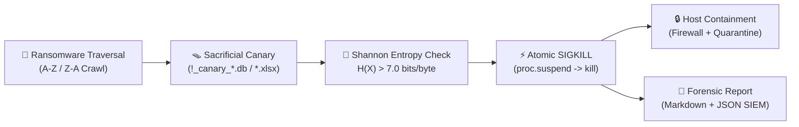

# 🛡️ CanaryShield

<div align="center">

[](https://www.python.org/)
[](https://attack.mitre.org/)
[](https://github.com/eshwarshetty06-creator/CanaryShield)
[](https://github.com/eshwarshetty06-creator/CanaryShield)

**Autonomous Anti-Ransomware Tripwire & Endpoint Detection and Response (EDR) Engine**

</div>

---

## 📌 Overview

**CanaryShield** is an endpoint deception and automated threat interception system designed to neutralize ransomware attacks at the millisecond of inception. 

By anticipating the deterministic alphabetical traversal patterns of ransomware crawlers (`A → Z` and `Z → A`), CanaryShield deploys a sacrificial multi-extension canary matrix at the top of protected directories. The moment an unauthorized process modifies a canary, CanaryShield analyzes the ciphertext using **Shannon Entropy**, freezes the offending thread, terminates the entire process tree via **SIGKILL (<150ms)**, activates Windows Firewall containment, and produces MITRE ATT&CK-mapped digital forensics.

---

## ⚡ How It Works



---

## ✨ Key Features

- **Multi-Extension Canary Fleet:** Deploys authentic decoys across multiple formats (`.db`, `.xlsx`, `.docx`, `.txt`, `.zip`, `.bak`) to trap format-specific lockers.
- **I/O Tar-Pit Delay:** A 2.28MB structured financial ledger forces disk I/O bottlenecks on crawlers, guaranteeing containment before user files are touched.
- **Shannon Entropy Engine:** Mathematically identifies cryptographic scrambling ($H(X) > 7.0$ bits/byte) to catch zero-day and polymorphic ransomware without relying on static signatures.
- **Sub-150ms Process Neutralization:** Freezes execution in memory (`proc.suspend()`) and delivers an unconditional `SIGKILL` to the process hierarchy.
- **Volume Shadow Copy (VSS) Guardian:** Intercepts adversarial attempts to delete system backups (`vssadmin delete shadows`, `wmic`, `wbadmin`, `bcdedit`).
- **Emergency Firewall Isolation:** Dynamically applies outbound Windows Firewall block rules to stop double-extortion key exfiltration and C2 beaconing.
- **Self-Healing Canaries:** Automatically re-arms breached decoys immediately after an attack is contained.

---

## 🎯 MITRE ATT&CK® Mapping

| ID | Technique | Tactic | CanaryShield Countermeasure |
| :---: | :--- | :--- | :--- |
| **T1486** | Data Encrypted for Impact | Impact | Shannon entropy spike ($H(X) > 7.0$) triggers instant process termination. |
| **T1083** | File & Directory Discovery | Discovery | Decoys placed at ASCII extremes (`!` and `zz_`) trap crawlers on first access. |
| **T1490** | Inhibit System Recovery | Impact | VSS Guardian terminates shadow copy deletion commands. |
| **T1059** | Scripting Interpreter | Execution | Script-aware quarantine isolates malware payload while protecting system runtimes. |
| **T1046** | Network Discovery / C2 | Exfiltration | Outbound Windows Firewall isolation rule halts C2 beaconing. |

---

## 🚀 Quick Start (Hands-On Lab)

### 1. Installation
```powershell
# Clone the repository
git clone https://github.com/eshwarshetty06-creator/CanaryShield.git
cd CanaryShield

# Install dependencies
pip install -r requirements.txt
```

### 2. Initialize the Sandbox
Populate the sandbox with clean baseline mock documents and primed canary decoys:
```powershell
python setup_environment.py
```

### 3. Launch the Defender
In your primary terminal, start the real-time defense monitor:
```powershell
python canary_monitor.py
```

### 4. Run the Attack Simulator
In a second terminal, trigger the safe mock ransomware attack:
```powershell
python mock_ransomware.py
```
> **Result:** The simulator targets the canary first, is instantly frozen and killed by SIGKILL, and all real user documents (`assignment.txt`, `photos_info.txt`, `resume.txt`) remain **100% intact**.

### 5. Verify Zero Data Loss
```powershell
python setup_environment.py --status
```

---

## 🏢 Enterprise EDR Agent (`edr_agent.py`)

For persistent background monitoring across multiple directories:

```powershell
# Check agent status and active folders
python edr_agent.py --status

# Protect a custom folder (e.g. Documents, Vault)
python edr_agent.py --add-folder "C:\Users\<User>\Documents"

# Run EDR agent in foreground
python edr_agent.py --run-foreground

# Background daemon control
python edr_agent.py --start
python edr_agent.py --stop

# Network containment controls
python edr_agent.py --isolate-network
python edr_agent.py --restore-network
```

---

## 📂 Project Structure

```text
CanaryShield/
├── config.py                 # Thresholds, canary fleet definitions, & MITRE mappings
├── canary_monitor.py         # Standalone lab defense engine (Watchdog, Polling, Entropy)
├── edr_agent.py              # Enterprise daemon (Multi-dir, VSS guardian, Firewall)
├── setup_environment.py      # Sandbox setup and blast radius status checker
├── mock_ransomware.py        # Forward A-Z safe attack simulator
├── advanced_mock_ransomware.py # Reverse Z-A & VSS tampering simulator
├── requirements.txt          # Python dependencies (psutil, watchdog, colorama)
├── sandbox/                  # Protected sandbox containing user files & tripwire decoys
├── quarantine/               # Isolated vault for neutralized payload scripts
└── logs/                     # Auto-generated Markdown & JSON forensic incident reports
```

---

## ⚠️ Disclaimer

The attack simulators (`mock_ransomware.py` and `advanced_mock_ransomware.py`) are strictly benign, non-destructive educational tools scoped exclusively to authorized lab folders.
