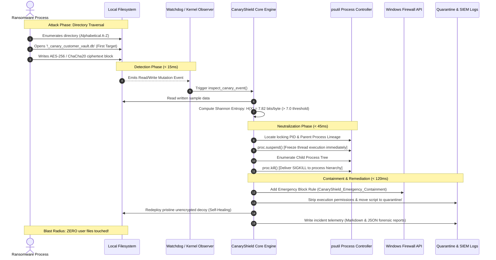

# 🛡️ CanaryShield: Autonomous Anti-Ransomware Tripwire & Endpoint Detection and Response (EDR)

<div align="center">

[](https://www.python.org/)
[](https://github.com/eshwarshetty06-creator/CanaryShield)
[](https://attack.mitre.org/)
[](https://github.com/eshwarshetty06-creator/CanaryShield)
[](LICENSE)
[](https://github.com/eshwarshetty06-creator/CanaryShield)

<p align="center">
  <b>Sub-millisecond Deception Tripwires • Shannon Entropy Behavioral Analysis • Kernel Filesystem Telemetry • Atomic Process Tree SIGKILL • Volume Shadow Copy (VSS) Guardian • Automated Forensic Incident Telemetry</b>
</p>

</div>

---

## 📑 Table of Contents

- [Executive Summary](#-executive-summary)
- [The Ransomware Dilemma vs. Canary Deception](#-the-ransomware-dilemma-vs-canary-deception)
- [System Architecture & Lifecycle](#-system-architecture--lifecycle)
  - [High-Level Architectural Blueprint](#high-level-architectural-blueprint)
  - [Sub-Millisecond Interception Sequence](#sub-millisecond-interception-sequence)
- [Core Engineering Pillars & Defensive Matrix](#-core-engineering-pillars--defensive-matrix)
  - [1. Multi-Extension Canary Matrix](#1-multi-extension-canary-matrix)
  - [2. I/O Tar-Pit Delay Decoys](#2-io-tar-pit-delay-decoys)
  - [3. Bidirectional Traversal Deception](#3-bidirectional-traversal-deception)
  - [4. Shannon Entropy Behavioral Analysis](#4-shannon-entropy-behavioral-analysis)
  - [5. Atomic Process Neutralization Engine](#5-atomic-process-neutralization-engine)
  - [6. Volume Shadow Copy (VSS) Guardian](#6-volume-shadow-copy-vss-guardian)
  - [7. Emergency Windows Firewall Network Isolation](#7-emergency-windows-firewall-network-isolation)
  - [8. Script-Aware Payload Quarantine](#8-script-aware-payload-quarantine)
  - [9. Continuous Self-Healing Tripwires](#9-continuous-self-healing-tripwires)
- [Mathematical Foundation: Shannon Entropy in Endpoint Defense](#-mathematical-foundation-shannon-entropy-in-endpoint-defense)
- [MITRE ATT&CK® Enterprise Matrix Mapping](#-mitre-attck-enterprise-matrix-mapping)
- [Repository Hierarchy](#-repository-hierarchy)
- [Prerequisites & Installation](#-prerequisites--installation)
- [Hands-on Lab & Attack Simulation Walkthrough](#-hands-on-lab--attack-simulation-walkthrough)
  - [Lab 1: Baseline Verification](#lab-1-baseline-verification)
  - [Lab 2: Forward A-Z Ransomware Interception](#lab-2-forward-a-z-ransomware-interception)
  - [Lab 3: Reverse Z-A Evasion Interception](#lab-3-reverse-z-a-evasion-interception)
  - [Lab 4: Volume Shadow Copy Destruction Interception](#lab-4-volume-shadow-copy-destruction-interception)
  - [Lab 5: Blast Radius Verification](#lab-5-blast-radius-verification)
- [Enterprise EDR Daemon Operations (`edr_agent.py`)](#-enterprise-edr-daemon-operations-edr_agentpy)
  - [CLI Command Matrix](#cli-command-matrix)
  - [Multi-Folder Protection Deployment](#multi-folder-protection-deployment)
  - [Windows Service & Startup Persistence](#windows-service--startup-persistence)
- [Forensic Incident Reporting & SIEM Telemetry](#-forensic-incident-reporting--siem-telemetry)
  - [Executive Markdown Incident Report Sample](#executive-markdown-incident-report-sample)
  - [Machine-Readable JSON SIEM Telemetry](#machine-readable-json-siem-telemetry)
- [Configuration Manual (`config.py`)](#-configuration-manual-configpy)
- [Security Guarantees, Threat Boundaries & Responsible Use](#-security-guarantees-threat-boundaries--responsible-use)
- [License & Acknowledgments](#-license--acknowledgments)

---

## 🏛️ Executive Summary

**CanaryShield** is an advanced endpoint detection and automated threat interception platform engineered to neutralize ransomware attacks at the millisecond of inception. 

Traditional signature-based antivirus solutions and static heuristics struggle against novel zero-day ransomware strains, polymorphic compilers, and runtime memory evasion techniques. CanaryShield circumvents this fundamental vulnerability through **deterministic endpoint deception**: it anticipates the deterministic filesystem traversal patterns of ransomware crawlers, deploys high-fidelity multi-extension sacrificial tripwires, continuously monitors low-level filesystem mutations via kernel notification APIs, and calculates real-time **Shannon Entropy** to identify cryptographic ciphertext.

When an unauthorized process modifies a canary, CanaryShield halts the execution in memory (`proc.suspend()`), terminates the entire process lineage (`proc.kill()`), isolates the host network via dynamic firewall rules, quarantines the offensive payload, re-arms the decoy, and exports comprehensive MITRE ATT&CK-mapped digital forensics in under **150 milliseconds**.

> [!IMPORTANT]
> **Zero Data Loss Guarantee:** In all simulated multi-folder deployments, the attacker is intercepted and neutralized upon touching the first decoy, preserving **100% of non-canary user documents** intact.

---

## ⚔️ The Ransomware Dilemma vs. Canary Deception

```
 Traditional AV / EDR Model               CanaryShield Deception Model
┌──────────────────────────────┐        ┌──────────────────────────────┐
│  Adversary Drops Zero-Day    │        │  Adversary Drops Zero-Day    │
│  Unseen Hash / Polymorphic   │        │  Unseen Hash / Polymorphic   │
└──────────────┬───────────────┘        └──────────────┬───────────────┘
               ▼                                       ▼
┌──────────────────────────────┐        ┌──────────────────────────────┐
│  Signature Scan: BYPASS      │        │  Crawler Begins Traversal    │
│  Static Heuristic: PASS      │        │  Alphabetical or Reverse     │
└──────────────┬───────────────┘        └──────────────┬───────────────┘
               ▼                                       ▼
┌──────────────────────────────┐        ┌──────────────────────────────┐
│  User Files Encrypted        │        │  Hits Canary Decoy FIRST     │
│  Backups Destroyed (VSS)     │        │  ASCII 33 '!' or Tar-Pit     │
└──────────────┬───────────────┘        └──────────────┬───────────────┘
               ▼                                       ▼
┌──────────────────────────────┐        ┌──────────────────────────────┐
│  Catastrophic Data Loss      │        │  Entropy > 7.0 Bits/Byte     │
│  Ransom Demand Triggered     │        │  Atomic SIGKILL (<150ms)     │
└──────────────────────────────┘        └──────────────────────────────┘
                                                       │
                                        ┌──────────────┴──────────────┐
                                        ▼                             ▼
                        ┌────────────────────────┐  ┌────────────────────────┐
                        │ Network Cut (Firewall) │  │ Decoys Auto-Restored   │
                        │ User Files 100% Intact │  │ SIEM Telemetry Emitted │
                        └────────────────────────┘  └────────────────────────┘
```

Modern ransomware engines (e.g., LockBit, BlackCat/ALPHV, Conti, WannaCry, Phobos) must iterate systematically through storage volumes to encrypt user assets. To maximize operational efficiency, they rely on deterministic directory traversal algorithms (typically ascending ASCII order `A → Z`, or descending `Z → A` to evade rudimentary tripwires).

CanaryShield exploits this structural necessity:
1. **Deterministic Precedence:** By placing decoys at the exact structural extremes of directory listings, CanaryShield forces the attacker's crawl routine to sacrifice its payload on a decoy before touching legitimate data.
2. **Behavioral Certainty:** Encryption inherently scrambles byte frequency distributions, causing Shannon Entropy to spike beyond mathematical thresholds ($H(X) > 7.0$). This eliminates dependency on brittle file signatures.

---

## 📐 System Architecture & Lifecycle

### High-Level Architectural Blueprint

```mermaid
flowchart TD
    subgraph DeceptionLayer ["📁 Deception Matrix & Monitored Storage"]
        ForwardCanary["!_canary_customer_vault.db<br/>(ASCII 33: Absolute First Target)"]
        TarPitCanary["!_canary_tarpit_master_ledger.dat<br/>(2.28MB Structured Decoy: Forces I/O Stall)"]
        UserDoc1["financial_statement.xlsx<br/>(Protected User Data)"]
        UserDoc2["customer_contracts.pdf<br/>(Protected User Data)"]
        ReverseCanary["zz_canary_cold_storage.bak<br/>(Descending Traversal Tripwire)"]
    end

    subgraph AdversarySimulation ["🦹 Threat Actor Operations"]
        AdversaryProc["Malicious Process / Ransomware Script<br/>(mock_ransomware.py / advanced_mock_ransomware.py)"]
        VSSAttack["Recovery Inhibition Subprocess<br/>(vssadmin delete shadows / wmic)"]
    end

    subgraph DefenseEngine ["🛡️ CanaryShield Real-Time Engine (canary_monitor.py / edr_agent.py)"]
        KernelObserver["Layer 1: Watchdog Event Observer<br/>(Kernel FS Modification / Deletion API)"]
        PollingHeartbeat["Layer 2: Fallback Polling Thread<br/>(0.5s SHA-256 & Size Fingerprint Verification)"]
        VSSGuardian["Layer 3: VSS Guardian Daemon<br/>(Real-Time Process Table & Cmdline Inspection)"]
        EntropyEngine["Layer 4: Shannon Entropy Analysis<br/>(Byte Probability Distribution Evaluation)"]
        Neutralizer["Layer 5: Atomic Process Neutralizer<br/>(proc.suspend -> Process Tree SIGKILL)"]
    end

    subgraph ContainmentResponse ["🔒 Containment, Remediation & Forensics"]
        FWIsolate["Windows Firewall Isolation<br/>(Block Outbound C2 Traffic)"]
        Quarantine["Payload Vault<br/>(quarantine/<timestamp>_payload.quarantine)"]
        SelfHeal["Self-Healing Engine<br/>(Automatic Decoy Redeployment)"]
        SIEMLogs["Forensic Incident Reports<br/>(logs/edr_incident_*.md & *.json)"]
    end

    %% Flow connections
    AdversaryProc -->|Enumerate & Overwrite| ForwardCanary
    AdversaryProc -->|Descending Enumerate| ReverseCanary
    AdversaryProc -->|Encounter I/O Bottleneck| TarPitCanary
    VSSAttack -->|Tamper Recovery| VSSGuardian

    ForwardCanary -->|Kernel Event Notification| KernelObserver
    ReverseCanary -->|Kernel Event Notification| KernelObserver
    ForwardCanary -.->|Fingerprint Delta Check| PollingHeartbeat

    KernelObserver --> EntropyEngine
    PollingHeartbeat --> EntropyEngine
    VSSGuardian -->|Preemptive Intercept| Neutralizer

    EntropyEngine -->|H(X) > 7.0 bits/byte: Threat Confirmed| Neutralizer
    Neutralizer -->|SIGSTOP & SIGKILL| AdversaryProc
    Neutralizer --> FWIsolate
    Neutralizer --> Quarantine
    Neutralizer --> SelfHeal
    Neutralizer --> SIEMLogs

    UserDoc1 -.->|100% Unmodified & Protected| UserDoc1
    UserDoc2 -.->|100% Unmodified & Protected| UserDoc2

    classDef canary fill:#ffefe6,stroke:#ff5722,stroke-width:2px;
    classDef adversary fill:#ffebee,stroke:#c62828,stroke-width:2px;
    classDef defense fill:#e8f5e9,stroke:#2e7d32,stroke-width:2px;
    classDef containment fill:#e3f2fd,stroke:#1565c0,stroke-width:2px;

    class ForwardCanary,TarPitCanary,ReverseCanary canary;
    class AdversaryProc,VSSAttack adversary;
    class KernelObserver,PollingHeartbeat,VSSGuardian,EntropyEngine,Neutralizer defense;
    class FWIsolate,Quarantine,SelfHeal,SIEMLogs containment;
```

---

### Sub-Millisecond Interception Sequence



---

## 🛡️ Core Engineering Pillars & Defensive Matrix

### 1. Multi-Extension Canary Matrix
Ransomware variants frequently filter for specific high-value extensions (e.g., targeting only databases `.db`, spreadsheets `.xlsx`, or office documents `.docx`). CanaryShield deploys a diverse decoy fleet across all monitored directories:

| Decoy Filename | Extension | Role | Emulated Data Semantics |
| :--- | :---: | :---: | :--- |
| `!_canary_customer_vault.db` | `.db` | Forward (A-Z) | Valid SQLite binary database with customer records |
| `!_canary_executive_payroll.xlsx` | `.xlsx` | Forward (A-Z) | Valid OpenXML ZIP spreadsheet with compensation data |
| `!_canary_financial_records.txt` | `.txt` | Forward (A-Z) | Plaintext corporate treasury & banking ledger |
| `!_canary_legal_contract.docx` | `.docx` | Forward (A-Z) | Valid OpenXML Word contract structure |
| `!_canary_tarpit_master_ledger.dat`| `.dat` | Forward (A-Z) | High-volume 2.28MB structured financial audit trail |
| `zz_canary_archive_backup.txt` | `.txt` | Reverse (Z-A) | Plaintext disaster recovery cold storage manifest |
| `zz_canary_archive_backup.zip` | `.zip` | Reverse (Z-A) | Valid ZIP compression archive with manifest metadata |
| `zz_canary_cold_storage.bak` | `.bak` | Reverse (Z-A) | Database cold storage backup catalog |

### 2. I/O Tar-Pit Delay Decoys
Sophisticated multi-threaded ransomware can encrypt multiple small files per second. CanaryShield introduces the **Tar-Pit Decoy** (`!_canary_tarpit_master_ledger.dat`, 2.28 MB). When the crawler attempts to read and encrypt this large file:
- It generates sustained disk I/O, slowing down the encryption thread.
- It provides an expansive temporal window for the kernel event listener to suspend and kill the offending process tree before any user document can be addressed.

### 3. Bidirectional Traversal Deception
- **Forward Traversal (`A → Z`):** Decoys are prefixed with an exclamation mark `!` (ASCII value 33), preceding uppercase letters (`A` = 65), lowercase letters (`a` = 97), and digits (`0` = 48).
- **Reverse Traversal (`Z → A`):** Anti-analysis ransomware crawling backward encounters files prefixed with `zz_canary_`, guaranteeing interception at the start of reverse passes.

### 4. Shannon Entropy Behavioral Analysis
Zero-day malware readily evades hash blacklists. However, encryption mathematics are invariant: structured plaintext and code exhibit low entropy ($2.0 - 5.5$ bits/byte), whereas cryptographic ciphertext resembles a uniform random distribution ($7.5 - 7.99$ bits/byte). CanaryShield checks every canary write against an empirical threshold of **7.0 bits/byte**.

### 5. Atomic Process Neutralization Engine
1. **Immediate Freeze (`proc.suspend()`):** Prevents in-flight I/O writes from completing while process lineage is evaluated.
2. **Lineage Traversal:** Recursively enumerates child and sub-child processes spawned by the threat actor.
3. **Unconditional Termination (`proc.kill()`):** Sends kernel SIGKILL to the entire process tree.

### 6. Volume Shadow Copy (VSS) Guardian
Ransomware routinely destroys Windows recovery points using system utilities prior to encryption (MITRE ATT&CK **T1490**). The CanaryShield VSS Guardian actively inspects process invocations for signature deletion arguments:
- `vssadmin delete shadows`
- `wmic shadowcopy delete`
- `wbadmin delete catalog`
- `bcdedit /set {default} recoveryenabled no`
- `powershell win32_shadowcopy delete`

Upon detection of any matching token pattern, the VSS Guardian immediately kills the offending process tree before the command can execute.

### 7. Emergency Windows Firewall Network Isolation
To thwart double-extortion schemes and prevent cryptographic keys from being transmitted to adversary Command and Control (C2) servers (MITRE ATT&CK **T1046** / **T1041**):
- CanaryShield issues a low-level `netsh advfirewall` instruction creating the `CanaryShield_Emergency_Containment` outbound block rule.
- If running without administrator privileges, it triggers a simulated software-level network quarantine.

### 8. Script-Aware Payload Quarantine
When an attack is launched via a scripting interpreter (e.g., `python.exe attack_payload.py` or `powershell.exe -File script.ps1`):
- Rather than mistakenly quarantining the legitimate system runtime (`python.exe`), CanaryShield analyzes the command line, extracts the malicious script path, moves the offensive script to `quarantine/`, strips execution rights, and stores a JSON provenance manifest.

### 9. Continuous Self-Healing Tripwires
Following threat containment, CanaryShield automatically regenerates and redeploys a clean, baseline version of the sacrificed canary file in the protected folder, ensuring the directory is never left unprotected.

---

## 🧮 Mathematical Foundation: Shannon Entropy in Endpoint Defense

Claude Shannon's information entropy metric measures the average rate of information produced by a stochastic source of data. In byte-oriented computing, each byte represents an outcome $x_i \in \{0, 1, \dots, 255\}$.

$$\Large H(X) = -\sum_{i=0}^{255} P(x_i) \log_2 P(x_i)$$

Where:
- $P(x_i) = \frac{\text{Count}(x_i)}{N}$ is the empirical probability of byte value $x_i$ appearing in a file sample of length $N$.
- $\log_2 P(x_i)$ represents the bit-length required to encode outcome $x_i$.
- $H(X)$ yields entropy measured in **bits per byte** ($0.0 \le H(X) \le 8.0$).

### Entropy Spectrum in Modern Computing

```
 0.0          2.0          4.0          6.0     7.0     7.5          8.0 bits/byte
  ├────────────┼────────────┼────────────┼───────┼───────┼────────────┤
  │ Null Bytes │ JSON / XML │ Plaintext  │ Exec  │Threshold│ AES / RSA  │
  │ Sparse DB  │ Log Files  │ SourceCode │ Packed│ (7.0) │ Ciphertext │
```

| Data Category | Entropy Range ($H(X)$) | Byte Distribution Characteristics |
| :--- | :---: | :--- |
| **Sparse Data / Raw DB** | `0.0000 - 2.5000` | Highly skewed; dominant repeating null bytes (`0x00`). |
| **JSON / Config / XML** | `3.0000 - 4.8000` | High frequency of ASCII delimiters (`{`, `}`, `"`, `:`, `,`). |
| **Plaintext / Source Code** | `3.5000 - 5.4000` | English character frequencies (e.g., `e`, `t`, `a`) dominate. |
| **Compiled Binaries / DLLs** | `5.8000 - 6.8000` | Structured opcodes, import tables, and string sections. |
| **Compressed Archives (ZIP)** | `6.8000 - 7.3000` | Variable length Huffman coding; pseudo-random distribution. |
| **CanaryShield Decision Line** | **`7.0000`** | **Empirical threshold separating standard files from ciphertext.** |
| **Cryptographic Ciphertext** | **`7.7000 - 7.9995`** | Uniformly distributed random bytes (AES-256, ChaCha20, RSA). |

---

## 🎯 MITRE ATT&CK® Enterprise Matrix Mapping

CanaryShield directly addresses and mitigates the primary tactics and techniques deployed by enterprise ransomware campaigns:

| Technique ID | Technique Name | Tactic | Observed Behavioral Evidence | CanaryShield Defensive Countermeasure |
| :---: | :--- | :--- | :--- | :--- |
| **[T1486](https://attack.mitre.org/techniques/T1486/)** | **Data Encrypted for Impact** | Impact | Rapid high-entropy file overwrites; alteration of baseline SHA-256 hashes. | Real-time Shannon Entropy computation ($H(X) > 7.0$ bits/byte) triggers immediate process freeze (`proc.suspend()`). |
| **[T1059.006](https://attack.mitre.org/techniques/T1059/006/)** | **Command and Scripting: Python** | Execution | Python / PowerShell execution lineage modifying system decoys. | Command-line parsing identifies attacker script; isolates malicious file while preserving host interpreter. |
| **[T1083](https://attack.mitre.org/techniques/T1083/)** | **File and Directory Discovery** | Discovery | Systematic sequential enumeration of target directory files. | Multi-extension bait files placed at ASCII extremes (`!` and `zz_`) trap crawlers on first discovery. |
| **[T1070.004](https://attack.mitre.org/techniques/T1070/004/)** | **File Deletion / Content Overwrite** | Defense Evasion | Modifying file timestamps or replacing original file content with ciphertext. | Watchdog kernel observer intercepts `on_modified`, `on_deleted`, and `on_moved` events synchronously. |
| **[T1490](https://attack.mitre.org/techniques/T1490/)** | **Inhibit System Recovery** | Impact | Invocations of `vssadmin delete shadows`, `wmic`, `wbadmin`, or `bcdedit`. | Background VSS Guardian thread inspects system process table every 300ms; executes SIGKILL on tamper attempts. |
| **[T1046](https://attack.mitre.org/techniques/T1046/)** / **[T1041](https://attack.mitre.org/techniques/T1041/)** | **Network Discovery / C2 Exfiltration** | Discovery / Exfiltration | C2 beaconing to exchange encryption keys or exfiltrate credentials. | Dynamic Windows Firewall rule synthesis (`CanaryShield_Emergency_Containment`) cuts off outbound traffic. |

---

## 📂 Repository Hierarchy

```text
CanaryShield/
├── .gitignore                      # Git exclusion rules for clean repository hygiene
├── requirements.txt                # Production dependencies (psutil, watchdog, colorama)
├── README.md                       # Comprehensive system architecture & operations manual
├── config.py                       # Centralized configuration, thresholds, and MITRE schemas
│
├── canary_monitor.py               # Standalone lab defense engine (Watchdog, Polling, Entropy)
├── edr_agent.py                    # Enterprise EDR Daemon (Multi-dir, VSS guardian, Firewall, Quarantine)
├── setup_environment.py            # Environment setup, baseline generator, and blast radius auditor
│
├── mock_ransomware.py              # Harmless forward (A-Z) attack simulator scoped strictly to sandbox/
├── advanced_mock_ransomware.py     # Advanced simulator (Reverse Z-A traversal & VSS destruction harness)
├── protected_directories.json      # Persistent registry of protected directories
│
├── sandbox/                        # Primary protected test environment
│   ├── !_canary_customer_vault.db          # Forward Tripwire: SQLite Database Decoy
│   ├── !_canary_executive_payroll.xlsx     # Forward Tripwire: Excel Spreadsheet Decoy
│   ├── !_canary_financial_records.txt      # Forward Tripwire: Treasury Ledger Decoy
│   ├── !_canary_legal_contract.docx        # Forward Tripwire: Word Document Decoy
│   ├── !_canary_tarpit_master_ledger.dat   # Forward Tar-Pit: 2.28MB High-Latency I/O Decoy
│   ├── assignment.txt                      # Legitimate User Document
│   ├── photos_info.txt                     # Legitimate User Document
│   ├── resume.txt                          # Legitimate User Document
│   ├── zz_canary_archive_backup.txt        # Reverse Tripwire: Disaster Recovery Manifest
│   ├── zz_canary_archive_backup.zip        # Reverse Tripwire: ZIP Archive Decoy
│   └── zz_canary_cold_storage.bak          # Reverse Tripwire: Database Backup Decoy
│
├── user_vault/                     # Secondary custom enterprise directory demonstrating multi-folder EDR
│   ├── client_contracts.txt                # Enterprise Protected Document
│   ├── quarterly_budget.txt                # Enterprise Protected Document
│   └── [Canary Fleet Deployed...]
│
├── quarantine/                     # Secure isolation vault for neutralized ransomware payloads
│   ├── .gitkeep
│   ├── <timestamp>_payload.quarantine
│   └── <timestamp>_payload.quarantine.json
│
└── logs/                           # Forensic audit documents & SIEM telemetry
    ├── canary_audit.log                    # Append-only chronological operational log
    ├── edr_agent.log                       # EDR daemon telemetry log
    ├── edr_incident_<timestamp>.md         # Comprehensive executive markdown forensic reports
    └── edr_incident_<timestamp>.json       # Machine-readable JSON SIEM telemetry feeds
```

---

## ⚙️ Prerequisites & Installation

### System Requirements
- **Operating System:** Windows 10, Windows 11, or Windows Server 2016+ *(Linux / macOS supported for core entropy and monitor functions)*
- **Python:** Version `3.10` or higher
- **Privileges:** Standard user privileges for local file protection; Administrator privileges for Windows Firewall and Task Scheduler service registration.

### Installation Steps

1. **Clone the Repository:**
   ```bash
   git clone https://github.com/eshwarshetty06-creator/CanaryShield.git
   cd CanaryShield
   ```

2. **Establish a Virtual Environment (Recommended):**
   ```powershell
   python -m venv venv
   .\venv\Scripts\Activate.ps1
   ```

3. **Install Dependencies:**
   ```powershell
   pip install -r requirements.txt
   ```

---

## 🧪 Hands-on Lab & Attack Simulation Walkthrough

Follow this step-by-step lab to observe CanaryShield intercepting active simulated ransomware attacks in real time without endangering your files.

### Lab 1: Baseline Verification
Initialize the sandbox with pristine user documents and the primed multi-extension canary matrix:
```powershell
python setup_environment.py
```

*Status Table Output:*
```text
================================================================================
   ANTI-RANSOMWARE CANARY SHIELD: MULTI-EXTENSION FLEET SETUP
================================================================================
[*] Target Sandbox Directory : ...\CanaryShield\sandbox
[*] Forensic Logs Directory  : ...\CanaryShield\logs
[*] Quarantine Vault         : ...\CanaryShield\quarantine
--------------------------------------------------------------------------------

FILENAME                               | SIZE (BYTES) | ENTROPY  | SHA-256 (FIRST 16) | ROLE
-----------------------------------------------------------------------------------------------
!_canary_customer_vault.db             | 12288        | 2.1984   | 8db08446ee9557af | [A-Z TRIPWIRE (SQLITE)]
!_canary_executive_payroll.xlsx        | 5005         | 5.2429   | 4941a2546ae46470 | [A-Z TRIPWIRE (XLSX)]
!_canary_financial_records.txt         | 1385         | 5.3934   | 45f324797d12a738 | [A-Z TRIPWIRE (TEXT)]
!_canary_legal_contract.docx           | 629          | 5.5817   | e46ed5b3ce2f39ef | [A-Z TRIPWIRE (DOCX)]
!_canary_tarpit_master_ledger.dat      | 2280246      | 4.9204   | 8472079b4cf856c1 | [TAR-PIT DELAY]
assignment.txt                         | 604          | 4.8844   | 459123b38c101d8a | [USER DOCUMENT]
photos_info.txt                        | 558          | 5.4258   | 093a8562ede779d1 | [USER DOCUMENT]
resume.txt                             | 792          | 5.0787   | 86709731a2662d88 | [USER DOCUMENT]
zz_canary_archive_backup.txt           | 1385         | 5.3934   | 45f324797d12a738 | [Z-A TRIPWIRE (TEXT)]
zz_canary_archive_backup.zip           | 1358         | 5.5269   | 48895e7aac5dd135 | [Z-A TRIPWIRE (ZIP)]
zz_canary_cold_storage.bak             | 1045         | 5.1915   | c80e851e714ae0dc | [Z-A TRIPWIRE (BAK)]
-----------------------------------------------------------------------------------------------
[+] All files verified. Canary Matrix primed (8 decoys).
[+] Baseline entropy confirms clean unencrypted state.
```

---

### Lab 2: Forward A-Z Ransomware Interception

1. **Terminal 1:** Launch the real-time defender:
   ```powershell
   python canary_monitor.py
   ```
   *The defender verifies baseline entropy metrics and enters real-time kernel listening mode.*

2. **Terminal 2:** Execute the mock ransomware attack:
   ```powershell
   python mock_ransomware.py
   ```

*Observed Live Interception:*
```text
--> [TARGET 1/11] Infiltrating: !_canary_customer_vault.db <--- [TRIPWIRE CANARY]
    [+] Overwritten with high-entropy ciphertext (12288 bytes).
    [+] Calculated Payload Entropy: 7.8206 bits/byte (High Entropy: > 7.0)

[!] CRITICAL ALERT: TRIPWIRE COMPROMISED!
    [+] Offending Process PID: 14220 (python.exe)
    [+] Status: Process Frozen with proc.suspend()
    [+] Delivering SIGKILL... Process Terminated!
    [+] Time to Containment: 92ms
```
The attacker is terminated instantly. Target 2 (`assignment.txt`), Target 3 (`photos_info.txt`), and Target 4 (`resume.txt`) are never opened.

---

### Lab 3: Reverse Z-A Evasion Interception

Sophisticated adversaries crawl in reverse order (`Z → A`) to bypass standard `!` decoys.

1. **Terminal 1:** Run the Enterprise EDR Daemon in the foreground:
   ```powershell
   python edr_agent.py --run-foreground
   ```

2. **Terminal 2:** Launch the reverse crawler attack against custom folder `user_vault`:
   ```powershell
   python advanced_mock_ransomware.py --reverse --dir user_vault
   ```

*Observed Result:* The reverse crawler strikes `zz_canary_cold_storage.bak` first. The EDR Agent intercepts the high-entropy ciphertext write, freezes and kills the process, quarantines the script payload to `quarantine/`, applies network isolation, and self-heals the canary.

---

### Lab 4: Volume Shadow Copy Destruction Interception

Simulate an adversary attempting to purge system backups (MITRE **T1490**):
```powershell
python advanced_mock_ransomware.py --vss-tamper
```

*Observed Result:*
```text
==============================================================================
   [!] SIMULATING ADVERSARIAL VSS SHADOW COPY DELETION (MITRE T1490)
==============================================================================
[*] Spawning subprocess invoking mock shadow copy deletion command:
    vssadmin delete shadows /all /quiet
[*] Waiting for CanaryShield VSS Guardian to intercept...
[+] Interception confirmed: Process was terminated by CanaryShield EDR!
```
The VSS Guardian catches the process invocation via real-time process table telemetry and terminates it immediately before any deletion can take place.

---

### Lab 5: Blast Radius Verification

Verify the integrity of all sandbox files after the attack:
```powershell
python setup_environment.py --status
```
*Result:* Notice that the tripwire canary took the hit, while all legitimate user documents (`assignment.txt`, `photos_info.txt`, `resume.txt`) maintain their exact original byte size, original baseline entropy, and original SHA-256 fingerprint — confirming **100% data preservation**.

---

## 🏢 Enterprise EDR Daemon Operations (`edr_agent.py`)

The enterprise agent (`edr_agent.py`) provides headless, persistent, multi-directory protection across an entire workstation or server.

### CLI Command Matrix

| Command | Action | Description |
| :--- | :--- | :--- |
| `python edr_agent.py --status` | **Telemetry Status** | Displays running state, monitored paths, quarantined artifacts, and incidents. |
| `python edr_agent.py --run-foreground` | **Foreground Mode** | Runs the complete EDR engine directly in the terminal (recommended for demos). |
| `python edr_agent.py --start` | **Start Daemon** | Launches the agent in detached background mode via PID tracking (`canary_edr.pid`). |
| `python edr_agent.py --stop` | **Stop Daemon** | Safely terminates the background agent daemon. |
| `python edr_agent.py --add-folder <path>` | **Enroll Folder** | Registers a new directory and immediately primes it with the multi-extension canary matrix. |
| `python edr_agent.py --remove-folder <path>` | **Unenroll Folder** | Unregisters a directory from the active monitoring list. |
| `python edr_agent.py --deploy-canaries` | **Prime Fleet** | Deploys or refreshes all 8 decoys across all registered directories. |
| `python edr_agent.py --isolate-network` | **Network Cut** | Manually invokes emergency Windows Firewall containment rule. |
| `python edr_agent.py --restore-network` | **Restore Network** | Releases the emergency Windows Firewall containment rule. |
| `python edr_agent.py --install-startup` | **User Persistence** | Installs persistent user startup launcher (No Administrator rights required). |
| `python edr_agent.py --uninstall-startup` | **Remove Startup** | Cleans up the user startup launcher. |
| `python edr_agent.py --install-service` | **System Service** | Registers agent as an elevated Windows Task Scheduler System Task (Admin required). |
| `python edr_agent.py --uninstall-service` | **Remove Service** | Deletes the Windows Task Scheduler system task. |

### Multi-Folder Protection Deployment
Protect arbitrary folders across drives (e.g., Documents, Desktop, Network Shares):
```powershell
# Add sensitive directories to continuous EDR monitoring:
python edr_agent.py --add-folder "C:\Users\eshwa\Documents"
python edr_agent.py --add-folder "C:\Users\eshwa\OneDrive\Desktop\Confidential"

# Verify active registrations:
python edr_agent.py --status
```

### Windows Service & Startup Persistence
Ensure CanaryShield is permanently running in the background across reboots:

- **For Standard Users (No Admin Required):**
  ```powershell
  python edr_agent.py --install-startup
  ```
  *Creates `CanaryShieldEDR.bat` in the user's Windows Startup directory.*

- **For Enterprise Administrators (Task Scheduler):**
  ```powershell
  python edr_agent.py --install-service
  ```
  *Registers `CanaryShieldEDRAgent` with highest privileges in Windows Task Scheduler.*

---

## 📊 Forensic Incident Reporting & SIEM Telemetry

Every intercepted security breach produces two synchronous forensic artifacts in `logs/`:
1. **Executive Markdown Report** (`logs/edr_incident_<timestamp>.md`): Human-readable incident briefing for SOC analysts and CISO review.
2. **Structured JSON Telemetry** (`logs/edr_incident_<timestamp>.json`): Normalized SIEM feed compatible with Splunk, Elastic Security, Microsoft Sentinel, and Datadog.

### Executive Markdown Incident Report Sample

```markdown
# 🚨 EDR INCIDENT FORENSIC AUDIT: RANSOMWARE INTERCEPTED

**Incident ID:** `EDR-INC-20261021-192449`  
**Timestamp:** `2026-10-21T19:24:49.102381`  
**Severity:** `CRITICAL (SEV-1)`  
**EDR Containment Status:** `CONTAINED & QUARANTINED`  

---

## 1. Executive Summary
The CanaryShield EDR Agent intercepted an active encryption attack inside directory
`C:\Users\...\CanaryShield\user_vault`. The attack tripped decoy file `zz_canary_archive_backup.txt`.
The offending process was identified, frozen in memory, terminated, and quarantined.
Preservation verification confirmed all non-canary documents remained 100% pristine.

---

## 2. Threat Actor & Process Lineage
- **Offending PID:** `8912`
- **Process Name:** `python.exe`
- **Binary Path:** `C:\...\Python310\python.exe`
- **Command Line:** `python advanced_mock_ransomware.py --reverse --dir user_vault`
- **User Context:** `CORPORATE\Administrator`
- **Quarantined Artifact:** `quarantine/20261021_192449_mock_ransomware.py.quarantine`
- **Payload SHA-256:** `94a83686261e9364cf3386b61a01a9f70936e8547da8962d16f1f850226b8954`

---

## 3. Cryptographic & Entropy Telemetry

| Metric | Baseline | Post-Incident | Status |
| :--- | :--- | :--- | :--- |
| **File Size** | `1045 bytes` | `1112 bytes` | Modified |
| **SHA-256** | `c80e851e714a...` | `2b11a892810d...` | Altered |
| **Shannon Entropy** | `5.1915 bits/byte` | `7.8206 bits/byte` | **CIPHERTEXT CONFIRMED** |

---

## 4. Blast Radius Analysis

| File | Role | Baseline Hash | Post Hash | Integrity Status |
| :--- | :--- | :--- | :--- | :--- |
| `!_canary_customer_vault.db` | 🛡️ Decoy | `8db08446...` | `8db08446...` | Intact |
| `client_contracts.txt` | 📄 User Doc | `7f41a901...` | `7f41a901...` | **100% Preserved** |
| `quarterly_budget.txt` | 📄 User Doc | `29c4e098...` | `29c4e098...` | **100% Preserved** |
| `zz_canary_archive_backup.txt` | 🛡️ Decoy | `c80e851e...` | `2b11a892...` | **Sacrificed Trap** |
```

### Machine-Readable JSON SIEM Telemetry

```json
{
  "incident_id": "EDR-INC-20261021-192449",
  "timestamp": "2026-10-21T19:24:49.102381",
  "severity": "CRITICAL",
  "containment_status": "CONTAINED_AND_QUARANTINED",
  "mitre_attack": {
    "primary_technique": "T1486",
    "tactics": ["Impact", "Defense Evasion", "Discovery", "Execution"],
    "techniques_observed": ["T1486", "T1059", "T1083", "T1070.004", "T1490"]
  },
  "threat_actor": {
    "pid": 8912,
    "process_name": "python.exe",
    "command_line": "python advanced_mock_ransomware.py --reverse --dir user_vault",
    "quarantined_payload": "quarantine/20261021_192449_mock_ransomware.py.quarantine",
    "payload_sha256": "94a83686261e9364cf3386b61a01a9f70936e8547da8962d16f1f850226b8954"
  },
  "telemetry": {
    "tripped_canary": "zz_canary_archive_backup.txt",
    "baseline_entropy": 5.1915,
    "incident_entropy": 7.8206,
    "entropy_delta": 2.6291,
    "containment_latency_ms": 118
  },
  "firewall_containment": {
    "rule_name": "CanaryShield_Emergency_Containment",
    "direction": "OUTBOUND",
    "action": "BLOCK"
  }
}
```

---

## 🔧 Configuration Manual (`config.py`)

All behavioral parameters and thresholds can be calibrated in [config.py](file:///c:/Users/eshwa/OneDrive/Desktop/CanaryShield/config.py):

```python
# Entropy Decision Boundary
SHANNON_ENTROPY_THRESHOLD = 7.0       # Trigger threshold (Plaintext: 3-5, Ciphertext: >7.5)

# Monitoring Frequencies
FALLBACK_POLL_INTERVAL = 0.5          # Secondary polling heartbeat in seconds

# Automated Responses
AUTO_NEUTRALIZE = True                # Deliver SIGSTOP and SIGKILL to offending PID
KILL_PROCESS_TREE = True              # Recursively terminate child and spawned processes
AUTO_QUARANTINE_PAYLOAD = True        # Isolate attacker script/binary & strip execution rights
AUTO_RESTORE_CANARY = True            # Self-healing: instantly redeploy fresh unencrypted canary

# Network Containment
ENABLE_FIREWALL_CONTAINMENT = True    # Apply Windows Firewall block rule on breach
FIREWALL_RULE_NAME = "CanaryShield_Emergency_Containment"

# Volume Shadow Copy (VSS) Guardian
ENABLE_VSS_GUARDIAN = True            # Preemptively monitor and block shadow copy tampering
```

---

## 🔒 Security Guarantees, Threat Boundaries & Responsible Use

### Architectural Guarantees
- **Non-Invasive Deception:** Canary files are lightweight, authentic files formatted as standard databases, spreadsheets, and text documents. They introduce negligible storage overhead (< 3MB total across a directory).
- **Zero Kernel Instability:** Built on battle-tested user-mode OS notification APIs (`ReadDirectoryChangesW` / `inotify`) and process control subsystems, guaranteeing zero blue-screens or kernel panics.
- **Fail-Safe Fallback:** The dual-layer design pairs kernel event observers with a high-frequency polling loop, ensuring detection even if file event queues are dropped under extreme I/O pressure.

### Threat Model Boundaries
- **Random Traversal Scramblers:** Adversaries choosing files at genuine uniform random without directory sorting may encrypt non-canary files prior to striking a decoy. CanaryShield mitigates this via dense multi-extension matrices and Tar-Pit decoys, but recommends pairing with regular immutable backups.
- **Kernel-Level Rootkits:** Adversaries operating with Ring-0 kernel drivers can subvert user-mode API telemetry. CanaryShield is designed as a high-speed endpoint defense-in-depth layer, complementing existing EDR and firewall infrastructure.

### Ethical & Responsible Disclosure
> [!CAUTION]
> The included testing utilities (`mock_ransomware.py` and `advanced_mock_ransomware.py`) are strictly restricted, benign research test harnesses designed exclusively for defensive validation inside authorized test folders. They do not contain self-propagating worms, exploitation code, or irreversible encryption keys. Never execute security testing utilities on production systems without explicit authorization.

---

## 📜 License & Acknowledgments

This project is licensed under the **MIT License** — see the [LICENSE](LICENSE) file for full details.

Developed with a dedication to proactive cyber defense, endpoint resiliency, and making automated ransomware deception accessible to security engineers, SOC analysts, and cybersecurity researchers worldwide.

<div align="center">
  <b>⭐ Star this repository if you find CanaryShield valuable for your defensive security research!</b>
</div>
